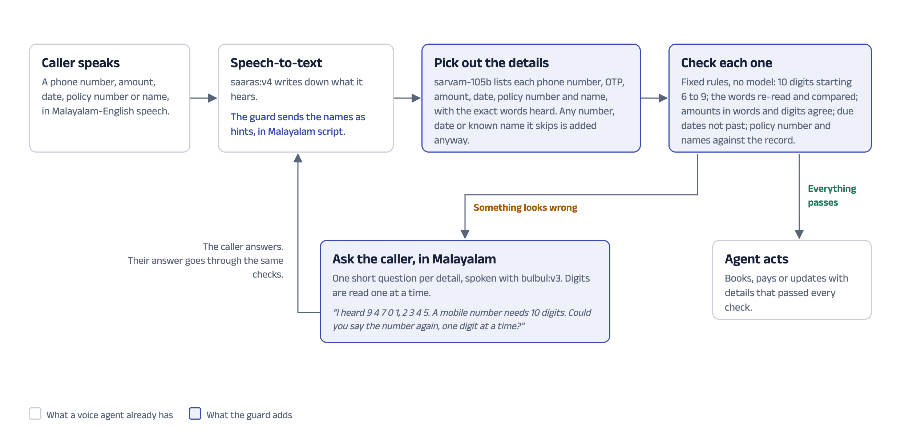

# Number & Name Guard

Voice agents for banks and insurers run on phone numbers, OTPs, policy numbers, amounts, dates and
names. In Malayalam-English speech, these are exactly the words speech-to-text gets wrong. One wrong
digit means a failed payment or a message sent to the wrong person, and today nothing stops it.

The guard sits between speech-to-text and the voice agent. It picks out every high-stakes detail,
checks each one with fixed rules, and when something looks wrong it asks the caller a short question
in Malayalam instead of letting the agent act on it.



## Where this came from

I tested Indus and the Sarvam APIs by hand in Malayalam and English (26 tests, in
`../sarvam-error-log.xlsx`). Three findings shaped the guard:

- **T05: a phone number came back wrong.** I said 98470 12345 to Indus voice. Speech-to-text heard
  number words that do not add up to one number (തൊണ്ണൂറ്റി നാൽപ്പത്തേഴ്, "ninety-and forty-seven"), and
  the number came back as 97012345, two digits short. Indus did notice and asked me to confirm.
- **T13 and T15: names break in mixed speech.** "Lulu Mall" came back as "ലു മാളിൽ" and Edappally became
  "എടാപ്പള്ളി". Background noise barely changed this. The name was the weak point.
- **T26: name hints only work in Malayalam script.** Speech-to-text accepts a list of words to listen
  for. Sent in English ("Lulu Mall", "Edappally") they changed nothing. Sent in Malayalam script they
  fixed "ലുലു". The documentation's example uses English words, with no warning.

## What it catches

**A number that cannot be right.** In T05 the model read the words as 947012345: nine digits. The guard
flags it for three separate reasons: there are only 9 digits, the words do not combine into one number,
and its own reading of the words (9047012345) does not match the model's. It then asks:

> ഞാൻ കേട്ടത് 9 4 7 0 1, 2 3 4 5. ഒരു മൊബൈൽ നമ്പറിൽ 10 അക്കങ്ങൾ വേണം. നമ്പർ ഒരു അക്കം വീതം ഒന്നുകൂടി പറയാമോ?
>
> "I heard 9 4 7 0 1, 2 3 4 5. A mobile number needs 10 digits. Could you say the number again, one
> digit at a time?"

The guard never trusts the model's digits on their own. It reads the Malayalam number words again with
fixed rules (including joined forms like പതിനാലായിരത്തി and amounts like നാലര ലക്ഷം), so even a model
that quietly "fixes" T05 to a valid-looking number still gets a question.

**A name that was misheard, or not picked up at all.** The customer's names (their branch, places and
people on file) go to speech-to-text as hints in Malayalam script, which is how "ലുലു" comes back right.
The guard then checks every name against the names on file and asks about close misses: "ഇടപ്പള്ളി
എന്നാണോ ഉദ്ദേശിച്ചത്?" ("Did you mean Edappally?").

**A detail the model skipped.** The extraction model often leaves out place names in casual speech, and
once dropped a date. Every number, date word and known name in the transcript must belong to some
detail; anything left over is checked anyway.

## Results

From the last run of `eval.py` (`eval/results.md` has every detail and transcript). "Without the guard"
uses speech-to-text with no name hints and the same extraction model, and the agent acts on whatever
comes out. "With the guard" adds the name hints, the checks and the questions.

| Cases | Details | Wrong values acted on, without the guard | With the guard | Asked about | False alarms | Not picked up (without / with) |
|---|---|---|---|---|---|---|
| Test audio from the error log | 11 | 2 | 0 | 4 | 0 | 6 / 0 |
| Text only (T05 as logged, and the recording script typed in) | 13 | 1 | 0 | 1 | 0 | 1 / 0 |
| My recordings (12 clips, one speaker) | 14 | 0 | 0 | 0 | 0 | 2 / 0 |
| All | 38 | 3 | 0 | 5 | 0 | 9 / 0 |

What it costs in time (medians):

| Step | Time |
|---|---|
| The guard's rule checks | 1.0 ms |
| Making the first question's audio, only when something is flagged | 1.08 s |
| Speech-to-text, without and with name hints | 0.79 s and 0.84 s |
| Extraction with sarvam-105b (same with or without the guard) | 0.74 s |

**How to read this honestly:**

- The 3 wrong values all come from the test audio and the logged T05 transcript. In my own 12
  recordings, speech-to-text got every detail right, so those show that the guard stays quiet when
  nothing is wrong (no false alarms), not that it catches errors.
- The test audio was made with text-to-speech. T13 and the three T15 clips are the same sentence at
  different noise levels, so they are 4 tests of one sentence, not 4 independent ones.
- "Asked about" for Edappally counts എടപ്പള്ളി as a mishearing, as the error log does. Some people do
  write it that way.

Each question was also played back into speech-to-text to check that it can be understood: in all 10
clips (5 questions, 2 voices), every digit, the amount and the name came back right
(`eval/m3_readback.json`).

## Try it

You need Python 3 and a Sarvam API key in `../.env` as `SARVAM_API_KEY=...`.

```bash
cd guard
python3 -m venv ../.venv
../.venv/bin/pip install -r requirements.txt
../.venv/bin/streamlit run app.py
```

The demo opens with T05. Pick any sample call on the left, or use "Upload audio" or "Type text" at the
top right to check your own. The customer on file and the question voice are in the side panel.

Other commands:

```bash
../.venv/bin/python -m pytest -m "not live"   # tests that need no API key
../.venv/bin/python -m pytest                 # everything, including live API calls
../.venv/bin/python eval.py                   # rerun the evaluation and rewrite eval/results.md
```

Model replies, speech-to-text results and question audio are saved in `.cache/`, so reruns are fast
and cost no extra API calls.

## How it is built

| File | What it does |
|---|---|
| `keyterms.py` | Turns the customer's names into Malayalam-script hints for speech-to-text. A small spelling list (`data/native_spellings.json`) wins over transliteration, which spells some places by sound (Tripunithura, Vyttila). |
| `stt.py` | Speech-to-text with saaras:v4 and those hints. Converts phone recordings to WAV and refuses clips over the 30-second limit. |
| `numwords.py` | Reads Malayalam number words and digits with fixed rules, and says when words do not combine into one number. |
| `extract.py` | One sarvam-105b call that lists each detail with the exact words heard, then fixed clean-up and the backstop for skipped numbers and dates. |
| `validate.py` | The rules for each kind of detail, each with a plain reason, plus the scan for names on file. |
| `confirm.py` | Writes one Malayalam question per flagged detail (with its English meaning) and speaks it with bulbul:v3. |
| `eval.py` | Runs every case with and without the guard and writes `eval/results.md`. |
| `app.py` | The demo. |

## What I learned about the Sarvam APIs along the way

These are worth passing to the API team, since each one cost time to find:

- **Name hints in English do nothing for Malayalam output** (T26 above). The documentation's example
  uses English hints.
- **`reasoning_effort: "low"` still thinks at length** on a two-sentence transcript, and at the default
  token limit it sometimes returned an empty answer. Turning thinking off gave the extraction times
  above.
- **Strict JSON schema output often turned into blank space** until the token limit. Plain JSON mode,
  with the shape described in the prompt, worked every time I tried it.
- **The same input can give different extractions** even at temperature 0. One run dropped a date,
  which is why the guard has a backstop for dates.

## What it does not do yet

- **Handle the caller's answer.** The guard asks the question; turning the reply into a corrected
  detail (yes, no, or a new number) is the next piece. The demo checks one turn at a time.
- **Live calls.** Clips are checked after they are recorded, up to 30 seconds each.
- **Other languages.** Only Malayalam and English. The number reader and the questions are Malayalam.
- **Some number forms.** English number words written in Malayalam script (such as "നൈന്റി എയ്റ്റ്") are
  not read yet. A single number word on its own is not backstopped, because ഒന്ന് ("one") often just
  means "please".
- **Dates like "next month 5th".** The model works out the calendar date; the guard checks it is a real
  date and not in the past, but does not work it out a second time.
- **Name matching is tuned on few examples.** How close a word must be to count as a known name (0.82)
  was set so that "നന്ദി" ("thanks") does not match ആനന്ദ് (Anand) while എടാപ്പള്ളി still matches
  ഇടപ്പള്ളി. It needs more real calls to set properly.
- **A real customer system.** The record is a mock (`data/mock_customer.json`).

## Next steps

1. Close the loop: understand the caller's yes, no or corrected number, and check the new answer the
   same way.
2. Test on real call audio from more speakers, with phone-line quality and background noise, to measure
   how often the guard catches errors there and how often it asks without need.
3. Run it on live, streaming calls, where the question has to come back within a second or two.
4. Add Hindi, Tamil and the other languages Sarvam's voice agents serve, starting with how each one
   says numbers.
5. Learn from corrections: when callers fix a name, add the right spelling to the hints for next time.
